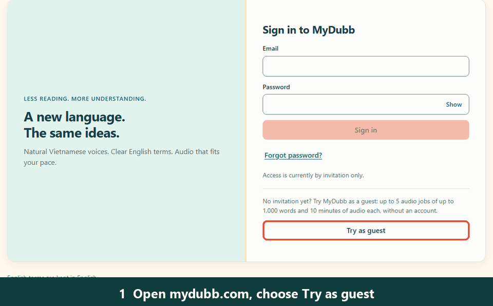
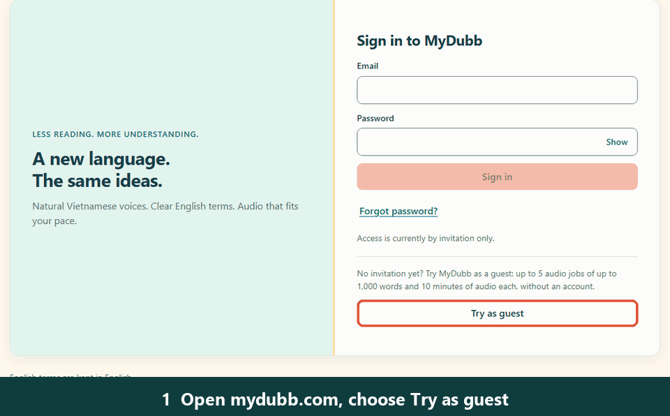

# MyDubb

**Turn an English transcript into Vietnamese audio you can listen to.**

### 👉 [mydubb.com](https://mydubb.com)

MyDubb is for people who learn from English technical content (talks, courses, videos) and want to
listen to it in Vietnamese. Paste an English transcript, or import the English captions of a YouTube
video, and MyDubb:

- translates it into Vietnamese and **keeps technical terms in English**, using a glossary of
  more than 2,000 technical terms (names, acronyms, tools, concepts);
- reads it aloud with the voice you choose, **Andrew Multilingual** (male) or **Emma Multilingual**
  (female), and reads the glossary's English terms in English;
- lets you pick the **speed** (0.5x to 2x) and fits the audio to the **timing** you give it, so it
  lasts as long as the part of the video you are dubbing;
- shows the Vietnamese translation next to the audio, so you can read along.

## See it work

Both demos ran on [mydubb.com](https://mydubb.com) in guest mode, with the voice and speed shown
under each one. Waiting time is shortened in the GIFs. Each audio link opens the full, unedited MP3
that MyDubb generated in that demo.

### Demo 1: paste a transcript

Voice: Andrew Multilingual · Speed: 1x

[🔊 Listen to the generated audio](https://cdn.jsdelivr.net/gh/chutieu312/mydubb@main/docs/assets/demo/demo-paste.mp3)

### Demo 2: import a YouTube video's English captions

Voice: Andrew Multilingual · Speed: 1x

[🔊 Listen to the generated audio](https://cdn.jsdelivr.net/gh/chutieu312/mydubb@main/docs/assets/demo/demo-youtube.mp3)

Both transcripts have timestamps, so MyDubb used its timed mode: it places the speech near the
caption times. That timing is an estimate, not exact sentence-by-sentence synchronization, and
stretches that are too long for their time slot are sped up (pitch preserved) to fit.

## How to use it

1. Open [mydubb.com](https://mydubb.com) and sign in with your invitation, or choose **Try as guest**.
2. Paste the English transcript (with or without timestamps), or choose **YouTube URL**, paste the
   link and choose **Import transcript**. MyDubb imports the English captions the video already has;
   it does not transcribe audio, so a video without English captions cannot be imported.
3. Check the **First Sentence Start Time** and **Last Sentence Start Time**. They are filled in for
   you when the transcript has timestamps; otherwise type them from your original transcript.
4. Pick a voice and an audio speed.
5. Choose **Generate audio**, read the Vietnamese translation, press **Play**, and download the MP3
   if you want to keep it. Results are kept for one hour.

At 1x the audio lasts exactly the time between the two start times. Other speeds make the audio
shorter or longer: 2x halves it, 0.5x doubles it.

## Try as guest: limits

You can try MyDubb without an invitation. Guest mode has these limits:

| | Limit |
|---|---|
| Audio jobs | 5 per guest session; guests on the same network share 20 per 24 hours (only completed jobs count) |
| Size of a job | up to 1,000 words and 10 minutes of audio |
| YouTube imports | 5 per guest session; 20 per network per 24 hours (counted separately from audio jobs) |
| Guest session | lasts 24 hours |

Invited accounts do not have these limits.

## Good to know

- English to Vietnamese only.
- A term that is not in the glossary may be translated, or pronounced imperfectly.
- Your text is sent to Microsoft Azure to translate it and create the audio. A YouTube link is sent
  to Supadata to fetch the captions.

## Technical documentation

[Technical documentation and setup](docs/README-original.md): architecture, API, authentication,
guest access, deployment and how to run MyDubb locally.
